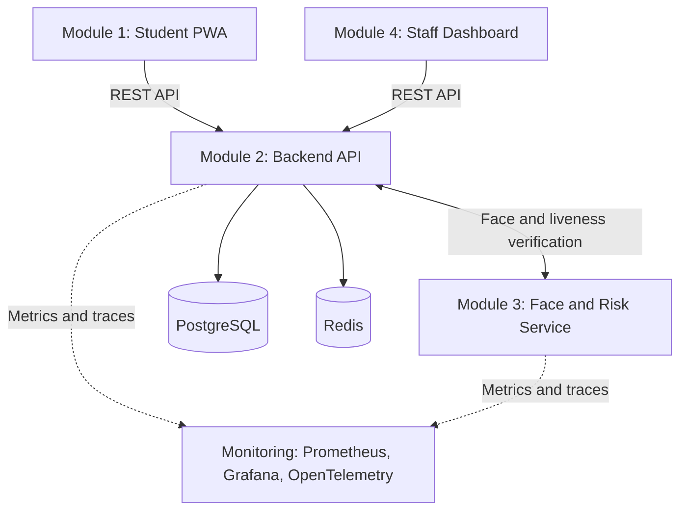

# SAIV - Secure Attendance & Identity Verification

**A student attendance PWA with identity checks, location verification and staff review.**

[Getting Started](#getting-started) · [Public Tests](#public-tests) · [Troubleshooting](#troubleshooting) · [Team](#team-contributions) · [Documentation](#documentation)

## Project Overview

SAIV helps teaching staff collect and review attendance while checking who is submitting, where they are and which browser/device they use. It addresses the limitations of a simple attendance form by combining face/liveness verification, geofencing, signed device proofs and an auditable review workflow.

- **Students** register, enroll their face, complete required verification and submit attendance through the PWA.
- **Instructors and teaching assistants** manage assigned sessions, inspect attendance and review flagged submissions within their access scope.
- **Administrators** manage accounts, courses, enrollment and device approvals.

The supplied Docker deployment runs locally with PostgreSQL and Redis. No Supabase project is required. Verification signals support attendance decisions; passing public tests does not prove resistance to every impersonation or presentation attack.

## Key Features

| Feature | What it provides |
|---|---|
| **Student check-in** | Session-based attendance with open/close windows, check-in history and read-only offline session snapshots |
| **Identity verification** | Face enrollment/comparison, configurable liveness checks and motion challenges, with presentation-attack detection |
| **Geofencing** | Venue-distance and location-accuracy checks that contribute to the attendance decision |
| **Device binding** | Browser keys, signed single-use challenges, per-account device approvals and shared-browser review |
| **Attendance review** | Instructor/admin dashboard for flagged submissions, statistics, attendance exports and audit inspection |
| **Account privacy** | Revocable app-consent settings, account closure and scheduled 30-day data cleanup |
| **Monitoring** | API/face-service metrics and tracing through Prometheus, Grafana and OpenTelemetry |

## System Architecture



The browser normally sends `/api/v1` requests through the frontend/dashboard proxy. The backend calls the face service internally. PostgreSQL stores application records; Redis holds rate-limit counters and refresh-token revocation state. Inside Docker, services use names such as `backend`, `postgres`, `redis` and `face-recognition` rather than host `localhost` addresses.

## Tech Stack

| Module / layer | Main technologies |
|---|---|
| **Module 1 — Student PWA** | Next.js 14, React, TypeScript, browser camera/geolocation APIs, IndexedDB |
| **Module 2 — Backend** | Python 3.11, FastAPI, SQLAlchemy, Alembic, JWT, bcrypt |
| **Module 3 — Face and risk** | FastAPI, dlib/face-recognition, MediaPipe, OpenCV, NumPy, SimHash, ONNX PAD models |
| **Module 4 — Dashboard** | React, TypeScript, Vite, TanStack Router/Query, Tailwind CSS |
| **Data and deployment** | PostgreSQL 15, Redis 7, Docker Compose |
| **Observability and tests** | Prometheus, Grafana, OpenTelemetry, pytest, HTTPX |

## Getting Started

### Prerequisites

Install Docker with Docker Compose v2 and start the Docker engine. Docker builds the Python and Node applications; host Python/Node installations are not required for this route. The first face-service build can take time because it builds native dependencies.

### Environment configuration

Compose supplies the backend's database URL using the bundled `postgres` service. An old `DATABASE_URL` in the root `.env` does not redirect this Docker backend to Supabase.

The default Compose values are sufficient for a local classroom setup. Optionally create/edit a root `.env`; preserve any existing secrets. For example:

```dotenv
POSTGRES_USER=saiv
POSTGRES_PASSWORD=saiv_password
POSTGRES_DB=saiv
POSTGRES_HOST_PORT=5434
STRICT_SECURITY_MODE=false
CORS_ORIGINS=http://localhost:3000,http://localhost:8501
```

Add `JWT_SECRET` with a randomly generated value before deploying beyond local development. Strict mode requires at least 32 characters. These example database credentials are for local development only.

Common configuration options:

| Variable | Default / purpose |
|---|---|
| `POSTGRES_USER`, `POSTGRES_PASSWORD`, `POSTGRES_DB` | `saiv`, `saiv_password`, `saiv` |
| `POSTGRES_HOST_PORT` | `5434`; container-to-container PostgreSQL still uses port `5432` |
| `JWT_SECRET` | Development fallback; replace with a random secret, at least 32 characters for strict mode |
| `STRICT_SECURITY_MODE` | `false`; strict mode adds deployment/account restrictions, including rejecting public staff registration |
| `CORS_ORIGINS` | `http://localhost:3000,http://localhost:8501` |
| `FORWARDED_ALLOW_IPS` | Empty: forwarded client addresses are not trusted; configure only actual sanitizing reverse proxies |
| `PAD_MODE`, `PAD_THRESHOLD` | `enforce`, `0.75` |
| `FACE_MATCH_HAMMING_FRACTION` | `0.1171875`, equivalent to 30 differing bits out of 256 |

The face service's default calibrated match-score threshold is `0.70`, corresponding to that 30-bit boundary; its liveness threshold is `0.85`. There is no shared-browser demo bypass in the submission configuration.

### Build and start

From the repository root:

```bash
docker compose up -d --build
docker compose ps
```

Check service readiness:

```bash
curl http://localhost:8000/health
curl http://localhost:8000/db-health
curl http://localhost:8001/health
```

### Localhost links

| Service | Local address |
|---|---|
| Student PWA | [localhost:3000](http://localhost:3000) |
| Instructor/admin dashboard through frontend | [localhost:3000/dashboard/](http://localhost:3000/dashboard/) |
| Dashboard directly | [localhost:8501/dashboard/](http://localhost:8501/dashboard/) |
| Backend API / Swagger | [localhost:8000/docs](http://localhost:8000/docs) |
| Face-service API / Swagger | [localhost:8001/docs](http://localhost:8001/docs) |
| Prometheus | [localhost:9090](http://localhost:9090) |
| Grafana | [localhost:3001](http://localhost:3001) — development login `admin` / `admin` |
| PostgreSQL from host tools | `localhost:5434`, default database/user/password `saiv` / `saiv` / `saiv_password` |
| Redis from host tools | `localhost:6380` |

The normal stack has persistent PostgreSQL, Prometheus and Grafana volumes. It uses local development credentials by default. Set appropriate secrets before exposing services beyond your development machine. Camera/geolocation require browser permission and a secure browser context: localhost works on the development computer; a phone accessing a LAN address generally needs HTTPS.

### Database updates

New databases receive application tables at backend startup. Existing databases can require explicit upgrades; `create_all` does not migrate existing columns or install new guards on existing tables. With the backend running:

```bash
docker compose exec backend alembic upgrade head
```

Migrations install audit protection/backfill retention deadlines and update future-account consent defaults. Existing consent choices are not overwritten. Changing PostgreSQL initialization credentials in `.env` does not change users/passwords in an already initialized volume.

### Accounts and a basic attendance flow

There is no automatically seeded application administrator. In default classroom mode, use Swagger's `POST /api/v1/auth/register` to create the initial account with `role: "admin"`, then log in. The same endpoint accepts student/instructor/TA accounts in this mode. In strict mode, public registration accepts students only; provision an administrator before enabling it and manage other users through authenticated admin APIs.

A typical flow is:

1. An administrator creates accounts, assigns instructors/courses and enrolls students.
2. Staff create a session with its venue, check-in window and verification requirements.
3. A student signs in, registers their browser/device and enrolls their face.
4. The student grants browser camera/location access, completes any required motion challenge and submits attendance during the open window.
5. Staff review flagged attendance in the dashboard.

The first registered device is automatically trusted; subsequent devices may need approval. A verified browser shared by multiple student accounts requires review even if that account's device is approved. Device signatures/challenges and biometric requirements remain separate checks.

<details>
<summary>Development commands and stopping services</summary>

### Development and shutdown

For frontend development, use Node 22.12+ with npm (the dashboard Dockerfile uses Node 22.12). Run `npm ci` and the module's `npm run dev`; inspect its `.env.example` for API/proxy settings. The student frontend provides `npm run typecheck` and `npm run build`; the dashboard provides `npm run build` and `npm run lint`. Restart/rebuild after changing browser build-time configuration.

For native backend development, start PostgreSQL/Redis with Compose, copy `module2-backend/.env.example` to `module2-backend/.env`, install `module2-backend/requirements.txt` in a Python 3.11 environment, and run from `module2-backend/`:

```bash
python -m app.server
```

Use the face-service container alongside it. The backend example targets host ports 5434/6380; inside Compose, services use ports 5432/6379 instead. Module dependencies and Dockerfiles are the implementation source of truth.

Stop the normal application without removing persistent data:

```bash
docker compose down
```

`docker compose down -v` also deletes the normal stack's PostgreSQL/Grafana/Prometheus volumes. Use it only when you intend to discard that data. The separate test-stack cleanup command above does not delete these application volumes.

</details>

## Project Structure

```text
SC3099-Capstone-Attendance-Application/
├── module1-frontend/         # Student PWA and browser verification flows
├── module2-backend/          # REST API, access rules and database migrations
├── module3-face-recognition/ # Face matching, liveness and risk service
├── module4-observability/    # Staff dashboard and monitoring configuration
├── tests/                   # Original public grading suite and scoring plugin
├── test-support/            # Disposable test runner and quota-isolation helper
├── sample_images/           # Public face-test fixtures
├── docs/                    # Specifications and module documentation
├── docker-compose.yml       # Normal local application stack
├── compose.public-tests.yml # Independent public-test environment
└── README.md
```

## Team Contributions

Primary module responsibilities:

| Team member | Role | Implemented components |
|---|---|---|
| **Chen Jia Wei** | Module 1 — Student frontend | Student PWA, check-in interface, camera/location and motion flows, browser/device settings, offline viewing |
| **Malishka** | Module 2 — Backend API | Authentication and access control, course/session/enrollment APIs, attendance processing, device binding, audit and retention logic |
| **Wang Cheng** | Module 3 — Face recognition and risk | Face detection/enrollment/comparison, liveness and motion verification, presentation-attack detection, risk scoring |
| **Ishita** | Module 4 — Dashboard and observability | Staff/admin dashboard, attendance review, statistics and exports, monitoring configuration |

## Public Tests

Tests send real HTTP requests and create accounts, courses, enrollments and attendance records. Use disposable services when possible. The original grading suite is now at **`tests/public/`**; `original-grading-tests/` was renamed to `tests/` without changing the original test contents.

### Recommended: isolated local test environment

This repository includes [compose.public-tests.yml](compose.public-tests.yml) and a [quota-isolation plugin](test-support/public_test_isolation.py). This setup:

- Builds the current backend and native face service, avoiding stale application images.
- Uses a separate PostgreSQL database and password-protected Redis on a project-specific Docker network, with **no published host ports** and no shared application volumes.
- Resets only `saiv:limit:*` counters **before each test's fixtures**, never during a test. Refresh-token revocation keys and database records remain intact between cases.
- Keeps real application rate limits and public test files/assertions unchanged.
- Rejects quota resets unless explicitly enabled with the dedicated test database/service addresses and verified PostgreSQL database/role. Do not point the helper at an ordinary application or shared Redis.

Run these commands from the repository root, using the same `-p` project name throughout:

```bash
# Build current sources and wait for the independent services to become healthy.
docker compose -p saiv-public-tests -f compose.public-tests.yml up -d --build --wait db redis face backend

# Build the small HTTP test runner and execute all public cases.
docker compose -p saiv-public-tests -f compose.public-tests.yml run --build --rm runner

# Remove the temporary services/network and their in-memory database state.
docker compose -p saiv-public-tests -f compose.public-tests.yml down
```

Inspect logs if startup fails:

```bash
docker compose -p saiv-public-tests -f compose.public-tests.yml logs --tail=100 backend face db redis
```

To select a file or case, pass pytest arguments after `runner`:

```bash
docker compose -p saiv-public-tests -f compose.public-tests.yml run --build --rm runner tests/public/test_api_functional.py -v
```

The current 97-case baseline was verified with this isolated setup: **96 passed, 1 pre-existing skip**. This result depends on per-test quota isolation; it is not a claim that the plain command below has the same result.

JUnit results are written to `test-results/public/public-tests.xml`, which is ignored by Git. A later run overwrites this report. `down` destroys the disposable PostgreSQL data; running the suite again without `down` retains earlier test records. For a fully fresh run, bring this test project down first and repeat the startup commands. The normal application stack can stay running throughout.

Run serially, without pytest-xdist: independent workers must not reset each other's quota windows. One existing concurrent-check-in test is explicitly skipped in the original suite; the helper does not remove that skip. Read pytest's final **passed / failed / errors / skipped** counts. The scoring plugin's percentage can exclude setup errors and must not be treated as an overall pass result when fixtures fail.

### Why plain runs can produce HTTP 429

The API specification requires **10 registrations/hour/IP**, **60 login attempts/hour/IP**, **10 check-in attempts/minute/user**, and **1,000 API requests/hour/user**. These remain enforced in default and strict modes.

The public suite repeatedly creates fresh accounts from one client IP. Without isolation, earlier tests consume the registration budget and later fixtures receive **429 Too Many Requests**. The concurrent-login integration case also registers accounts before logging in; rejected registrations make those logins fail. A fresh database/Redis at the start does not prevent the suite itself exhausting its allowance. Repeated plain runs can retain quota usage in Redis.

Per-test quota isolation is an **additional test-environment condition**, not an application fix and not identical to a plain `pytest` run. A registration-limit test can still reach 429 within its own test because counters are not cleared during that test. Do not disable production limits or use `FLUSHALL` on a shared Redis to make the suite pass.

### Plain terminal run against running services

For an unmodified suite run against the normal local services, use Python **3.11** and a virtual environment:

```bash
python3.11 -m venv .venv
source .venv/bin/activate
python -m pip install -r test-support/requirements.txt
python -m pytest tests/public -v
```

On Windows, activate with `.venv\Scripts\Activate.ps1` instead. The minimal HTTP dependencies above are enough for the public client tests; native face dependencies run in the service container. `requirements-test.txt` retains the broader starter dependency list, while each module has its own runtime dependencies.

The test clients default to `http://localhost:8000` and `http://localhost:8001`. To target other test services, set `TEST_BACKEND_URL`, `API_BASE_URL` and `TEST_FACE_URL` before running pytest. This plain command does **not** enable quota isolation and can hit the limits described above. Do not run data-creating tests against production/shared databases.

## Troubleshooting

| Symptom | Check / resolution |
|---|---|
| **403 “Insufficient permissions”** during session/course setup | Verify the running backend matches the checkout. Original fixtures create unassigned courses; current code includes narrow instructor compatibility for those cases. An older image can lack it. Rebuild using the command below. Assigned-course restrictions still apply. |
| **403 “Camera and geolocation consent are required”** | An account has withdrawn an app-consent flag. Inspect its Settings or `/api/v1/users/me`. Browser permission and app consent are separate. |
| **429 / many fixture errors** | Use the isolated test runner above; PostgreSQL cleanup alone does not clear Redis rate-limit counters. |
| **503 “Security service unavailable”** | Redis is unavailable/misconfigured. Inspect `docker compose ps` and backend/Redis logs. |
| Backend or face tests skip as unavailable | Check `/health`, the requested test URLs and container logs. Wait for startup rather than treating skipped tests as passes. |
| **400 “Course code already exists”** in a fixture | Public fixture codes use a short random suffix, so collisions can occur. Recreate only the disposable test project and rerun; retain the application's uniqueness check. |
| Camera/location blocked | Check browser site permissions and HTTPS/localhost. App Settings cannot override a browser-level denial. |
| PostgreSQL host port already used | Set `POSTGRES_HOST_PORT` to an unused host port and recreate the normal stack. The isolated test stack publishes no ports. |

After changing backend source or Compose environment, rebuild/recreate the backend. A simple restart keeps the old image/environment:

```bash
docker compose up -d --build --force-recreate backend
```

The same principle applies to `face-recognition`, `frontend` and `dashboard`. Inspect runtime state without printing credentials:

```bash
docker compose ps
docker compose logs --tail=100 backend face-recognition
```

The current Compose backend connects to local PostgreSQL. Recreating an old Supabase-configured container switches its target; it does not migrate accounts or data from Supabase.

## Documentation

- [API specification](docs/API-SPECIFICATION.md)
- [Database design](docs/DATABASE-SCHEMA.md)
- [Security requirements](docs/SECURITY-REQUIREMENTS.md)
- [Integration guide](docs/INTEGRATION-GUIDE.md)
- [Module 1](docs/module1.md), [Module 2](docs/module2.md), [Module 3](docs/module3.md), [Module 4](docs/module4.md)

The documents include starter/recommended designs; the implementation notes identify known deviations. Passing public HTTP tests does not establish resistance to every presentation attack, production readiness or compliance with every requirement.

<details>
<summary>Security, privacy and implementation details</summary>

### Implementation notes

- Authentication uses bcrypt password verification, JWT access/refresh tokens and database-authoritative roles. Refresh rotation/logout revocation and quotas require Redis in both modes. Course/session scopes, device signatures and single-use challenges are enforced by the backend.
- **App consent currently defaults to enabled for new accounts**, an authorized implementation deviation from the recommended schema's `FALSE` defaults. Students can revoke either flag in Settings, after which check-in is rejected. The browser independently controls camera/location access and may prompt when access is first requested. Migration changes future defaults only.
- Captured images and full face embeddings are processed in memory in the normal application paths; stored face templates are **256-bit SimHash**, not SHA-256. Although both can be represented by 64 hexadecimal characters, SimHash retains similarity information for matching. The literal SHA-256 wording in the original security document is an unresolved specification mismatch; do not claim SHA-256 compliance or biometric irreversibility from the template's length.
- Account deletion immediately disables access and schedules personal-data cleanup 30 days later. Cleanup removes associated student records, clears biometric/consent data, anonymises the account and preserves an audit-history anchor. Check-ins separately expire after 30 days, including legacy records with missing deadlines. Cleanup runs in batches approximately every 60 seconds while the backend is running; backlogs/downtime can delay execution.
- Audit logs remain append-only and are retained. PostgreSQL pool settings are 10 retained connections plus up to 20 overflow connections per backend process.
- Offline PWA storage contains sanitised session/attendance snapshots for viewing; it does not authenticate an offline user or replace server-side check-in verification.
- Default classroom mode permits privileged registration for local setup/grading. Strict mode is a separate deployment choice, not an automatic production-hardening guarantee. Review secrets, HTTPS, CORS and exact reverse-proxy trust before deploying.

</details>
